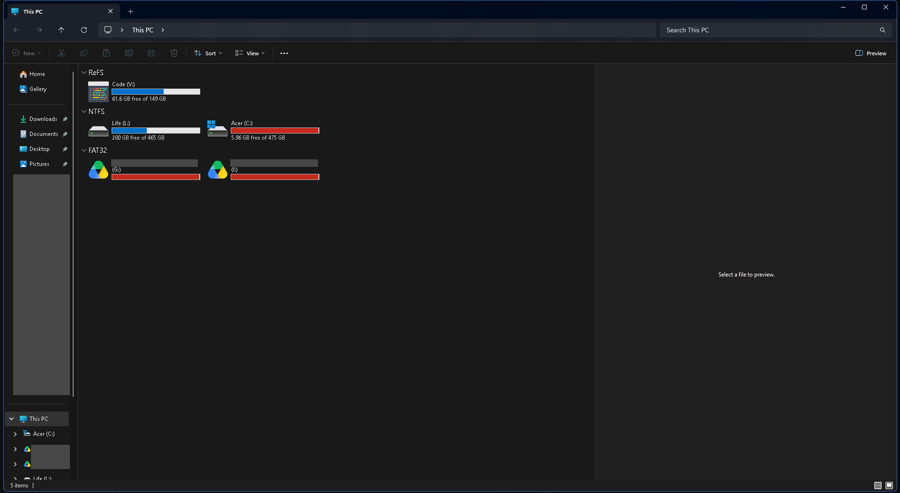
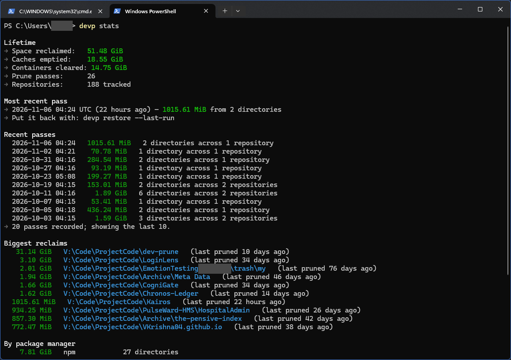
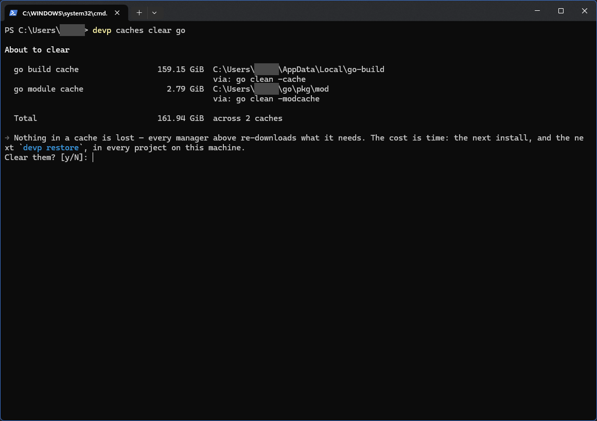
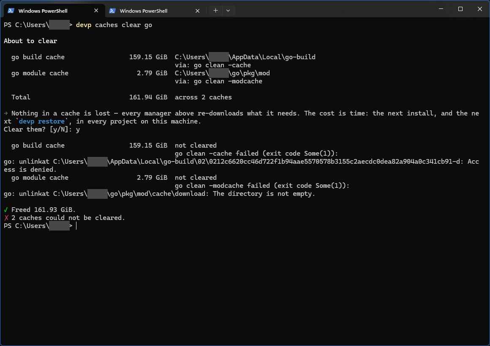
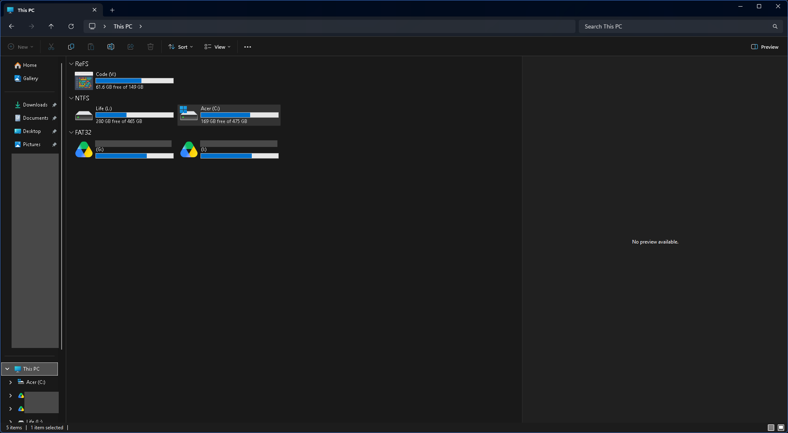
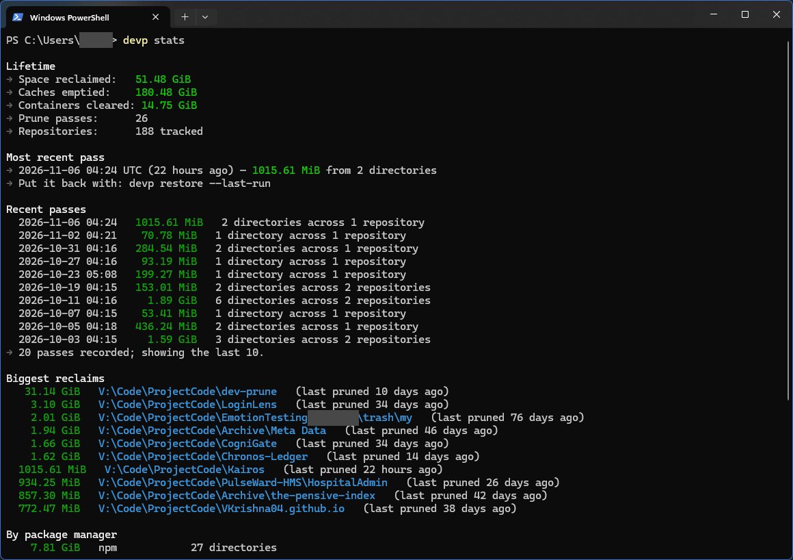

<!--
Copyright 2026 VKrishna04
SPDX-License-Identifier: Apache-2.0
-->

# A 160 GiB cache, and what it changed

This is a record of one real afternoon on the maintainer's own laptop: what dev-prune
found, what went wrong while it did, and what was fixed afterwards. The screenshots are
real captures. The Windows user name, a company name in one path and the personal
folders in File Explorer's sidebar are covered by grey boxes; nothing else is touched.

## The problem

The C: drive was at 98%. File Explorer showed 5.96 GB free of 475 GB.

Nothing in the projects folder was the cause. The project folders live on V:. The space
was in a package manager cache that no repository ever pointed at.

## What devp showed

`devp stats` before the cleanup. Lifetime caches emptied: 18.55 GiB.

`devp caches` then measured every cache it knows about. The Go build cache was
159.15 GiB, the Go module cache another 2.79 GiB.

## The result

`devp caches clear go` freed 161.93 GiB. C: went from 5.96 GB to 169 GB free. Lifetime
caches emptied went from 18.55 GiB to 180.48 GiB.

## What went wrong on the way

Four things were visible in that session. Each became a change in 1.24.0.

1. **It was slow, and it did not say why.** Measuring a cache with millions of small
   files took 4 minutes 44 seconds, and the screen showed one line, "Measuring package
   manager caches...", the whole time.

   

   Sizing now runs on several threads, and the progress line names the cache or
   repository it is on, counts the ones finished, and after ten seconds on one item says
   it is still measuring and that nothing is deleted.
2. **`devp status` was slow too.** Scanning 187 repositories took 58 to 75 seconds, mostly
   because discovery asked the disk the same question once for every package manager. It
   now asks once per folder.
3. **The output contradicted itself.** Go on Windows reported files it could not remove
   (access denied), and the tool still printed a green "Freed 161.93 GiB" under a "not
   cleared" line. A clear that only partly worked now gets a "partly cleared" row with the
   amount freed and the reason, and `--json` has a `partial` field.
4. **Scans could hang a scheduled pass.** A scan has no overall time limit, on purpose: a
   long scan that keeps making progress should finish. The real risk was a single `git`
   call that never returns, which would block every later scheduled run. Read-only git
   calls now give up after two minutes, skip that repository and say which one.

The same pass also taught the registry to look after itself: a moved repository is found
again by its first commit and keeps its history, and entries that stay missing for 30
days (or whose linked worktree was pruned) are dropped, but never when the drive they
lived on is simply unplugged.

## Numbers

Measured on the same laptop (Windows 11, 159 to 187 registered repositories, 160 GiB Go
build cache present, machine mostly idle), release build, read-only commands, three runs
each.

| Command | Before | After 1.24.0 |
|---|---|---|
| `devp caches` | 4 min 44 s | 20 to 29 s |
| `devp status` | 58 to 75 s | 21 to 24 s warm, 46 s on a cold first run |

The floor for `devp caches` is the operating system answering file-stat calls, not
dev-prune's own work: more threads past about eight make it slower, not faster.
