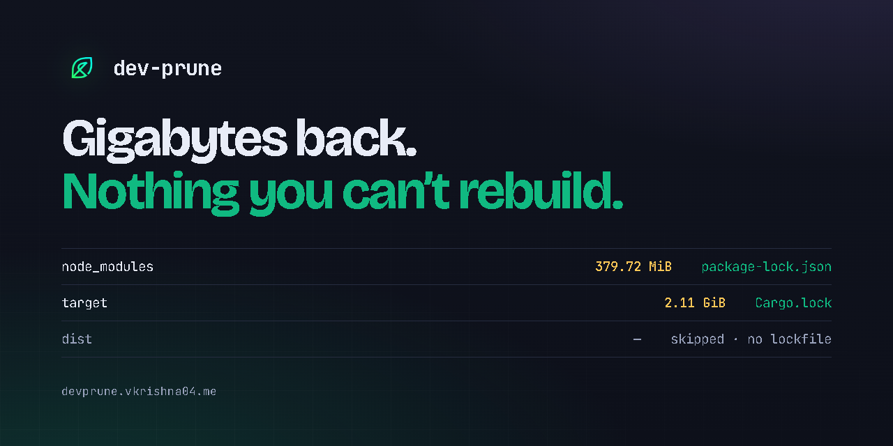

# dev-prune documentation

Index of the documentation for **`dev-prune`** (`devp`), a lockfile-safe CLI that reclaims
disk space from idle Git repositories. The docs are grouped by what you are trying to do.
Each entry says what you get from reading it.

  

---

## Using dev-prune

| Doc | What you get |
|---|---|
| [CLI reference](CLI_REFERENCE.md) | Every subcommand, global flag, setting, exit code and `--json` document. |
| [Install guide](RELEASES_AND_MANUAL_INSTALL.md) | The one-liner installers and their options, manual installs of the release binaries, and building from source. |
| [Install channels](DISTRIBUTION.md) | Every way to install (shell, PowerShell, npm, PyPI, Cargo, Homebrew, Scoop, WinGet) and what each one ships. |
| [Background automation](BACKGROUND_AUTOMATION.md) | What `devp setup` installs: the OS schedulers (Task Scheduler, LaunchAgent, systemd timers) and the Git hooks, and how to turn them off. |
| [Opt-in build adapters](OPT_IN_BUILD_ADAPTERS.md) | The eighteen adapters that ship switched off (compilers, build tools, game engine caches), and why they are a separate class. |
| [IDE and editor integration](IDE_INTEGRATION.md) | Schema IntelliSense and the extension for `.devprune.json`, and the Claude Code plugin marketplace this repository doubles as. |
| [Set up with an AI assistant](AI_SETUP_PROMPT.md) | A copy-paste prompt that has Claude Code, Cursor, Copilot or any terminal-capable agent install and configure dev-prune for you. |
| [Privacy and network policy](PRIVACY.md) | What dev-prune sends over the network (almost nothing), and how to check that yourself. |

### AI pair programming

AI coding assistants can read the token-efficient skill definition at
[`.agents/skills/dev-prune/SKILL.md`](../.agents/skills/dev-prune/SKILL.md), or run
`devp skill` to print ready-to-copy onboarding prompts.

## Understanding how it works

| Doc | What you get |
|---|---|
| [Why dev-prune refuses](WHY.md) | The argument the design came from: the hard problem is knowing which directory you cannot delete. |
| [Case study: a 160 GiB cache](CASE_STUDY.md) | One real cleanup on a nearly full C: drive, with screenshots, what went wrong during it, and the measured speedups that followed. |
| [Safety invariants](SAFETY_INVARIANTS.md) | The seven guarantees (`.git` boundary, lockfile pre-verification, symlink refusal, atomic writes and the rest) and why each exists. |
| [Architecture overview](ARCHITECTURE.md) | The entry point to the design docs below. |
| [High-level design](architecture/HLD.md) | The layers, the data flow of a prune pass, and the sequence diagrams. |
| [Low-level design](architecture/LLD.md) | The module map, the `registry.json` and `.devprune.json` schemas, the `PackageManager` trait contract and the atomic state swap. |
| [Market analysis](MARKET_ANALYSIS.md) | How dev-prune compares with kondo, npkill, cargo-clean-all and similar tools. |

## Contributing and releasing

| Doc | What you get |
|---|---|
| [Contributing guide](../CONTRIBUTING.md) | Environment setup, formatting, linting, tests, and the pull request checklist. |
| [Adding an adapter](ADDING_ADAPTERS.md) | A step-by-step tutorial for supporting a new package manager, with the testing conventions. |
| [Translating dev-prune](TRANSLATIONS.md) | How the twelve language catalogues work, which strings are translated, and how to add another language. |
| [Re-recording the demo](../scripts/demo/README.md) | How the README and landing-page clips are made: the VHS tapes, the throwaway sandbox that gets pruned, the two waits that are cut, and how to re-record after a release. |
| [Releasing](RELEASING.md) | The maintainer's guide: registry setup and credentials, what a tag push triggers, the changelog contract, and recovery when a release goes wrong. |
| [Roadmap](ROADMAP.md) | What is not built yet, grouped by why: in flight, next, on request, and declined with the reason. |

## Troubleshooting

Start at the [troubleshooting index](troubleshooting/README.md), which is organised by
symptom. The sub-guides:

| Doc | What you get |
|---|---|
| [Installation, PATH and permissions](troubleshooting/INSTALLATION_ISSUES.md) | Fixes for `devp` not found, permission errors, blocked scripts on Windows, and where each package manager puts the executables. |
| [Lockfile sync and adapter errors](troubleshooting/LOCKFILE_AND_ADAPTERS.md) | Lockfile sync failures, timeouts, a missing package manager, offline runs, and projects that were not found. |
| [Background daemon and Git hooks](troubleshooting/DAEMON_AND_HOOKS.md) | Scheduled runs that do not fire, and hooks that are missing or in the way. |
| [Uninstall, reinstall and state recovery](troubleshooting/UNINSTALL_AND_REINSTALL.md) | Removing every trace cleanly, and starting over. |
| [Registry corruption and edge cases](troubleshooting/CORRUPTION_AND_EDGE_CASES.md) | A damaged registry, bad `.devprune.json` syntax, renamed workspaces, symlinks, network mounts and a full disk. |
